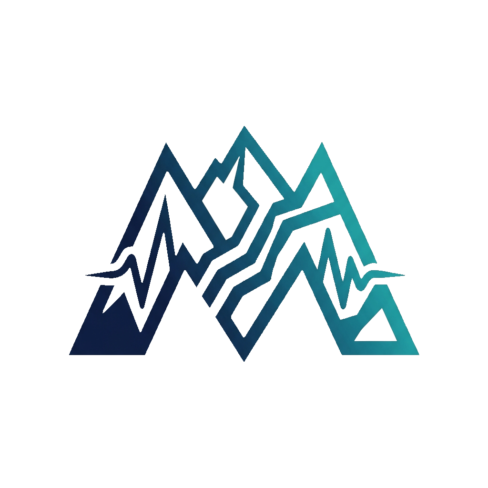

<strong>English</strong> · <a href="README.es.md">Español</a>

  

# MIRAGE for QGIS

**Extract raster signatures. Review them in their geospatial context.**

Geological, archaeological and potential-field morphology through a QGIS dock
and Processing tools, backed by one shared Python core.

## Start in QGIS

1. Download MIRAGE_QGIS_1.1.0.zip from the [latest release](https://github.com/jordan-zav/MIRAGE/releases/latest).
2. Open Plugins → Manage and Install Plugins → Install from ZIP. Select the full ZIP.
3. Enable MIRAGE and open Raster → MIRAGE.
4. If the panel reports missing image libraries, install them with its button.
   This needs internet and uses a separate directory, retaining QGIS' native libraries.
5. Load a GDAL file raster, select your interpretation goal and a starting profile.
6. Optionally request heuristic recommendations, then inspect Advanced parameters.
7. Select a new or empty output folder and extract. The GeoPackage loads into QGIS.
8. Compare the result with the input raster, maps, imagery and independent evidence.

This is the **first experimental QGIS edition**, tested on QGIS 3.44.12 for
Windows/Python 3.12. It is distributed as an installable GitHub ZIP; a listing in
the official QGIS Plugin Repository is not implied. Other compatible QGIS 3.40+
environments still need platform-specific checking.

## What MIRAGE does

| Workflow | Included capability |
| --- | --- |
| Geological signature | Multiscale edges, morphological cleanup, linking and filtering |
| Archaeological geometry | Parameters favouring connected angular or closed shapes |
| Geophysics | TDR, analytic signal, vertical derivatives, THDR and curvature-based ridges/troughs |
| Recommendations | Heuristic starting profiles from sampled raster characteristics |
| Review | Native QGIS raster/layer selection, background task and GeoPackage loading |
| Automation | Processing, Python API and standalone CLI using the same core |

Profiles change processing parameters. They **do not identify the origin of a
feature**. Roads, drainage, illumination, raster seams and noise may resemble a
geological or archaeological target. Recommendation scores are not calibrated
probabilities and are not a trained geological classifier.

## Processing and batch use

The MIRAGE provider registers:

- mirage:extract_signatures — raster extraction, GeoPackage, Shapefile and reports.
- mirage:recommend_parameters — a sampled heuristic recommendation written to JSON.

Both appear in Processing and can be used in batches or models. Give every
extraction its own output folder. The QGIS core runs serially inside a task;
cancellation is checked between numerical stages, not inside every library call.

## Inputs and spatial rules

Supported file inputs are single-band, RGB or RGBA rasters readable by GDAL,
with a defined CRS and a non-singular affine transform. Web-map services are not
direct processing inputs: export a suitable local raster first.

- NoData, non-finite values and transparent pixels are excluded from signatures.
- Invalid areas are buffered for filtering and excluded from the final linework.
- Geophysics requires a complete, north-up square grid in a projected CRS with
  metre units. Fill gaps or warp explicitly; MIRAGE does not silently repair surveys.
- Simplification uses source CRS units. For geographic rasters the panel sets
  FTHR to zero; use zero or reproject before applying a nonzero tolerance.
- The default input cap is 16 million pixels. Increasing it requires sufficient
  memory; full out-of-core tiling is not implemented. Crop large inputs deliberately.
- A valid run may detect zero features. It then produces an empty, valid vector
  layer and a completed report rather than inventing a detection.

## Outputs and traceability

| Product | Contents |
| --- | --- |
| lineaments.gpkg | The review layer loaded by the panel |
| lineaments.shp and sidecars | Shapefile geometry and extraction attributes |
| mirage_report.json | Parameters, source hash, CRS, version and summary statistics |
| mirage_report.md | Human-readable execution report |
| mirage_run.json | Running, complete, failed or cancelled execution state |

Previous outputs are never overwritten. If a task fails or is cancelled, keep
its manifest and choose a fresh directory for the next attempt.

pix_len is pixel-space line length; map_len and chord use source CRS units.
Summary lengths are reported in metres using projected-unit conversion or
geodesic calculation. Preserve the original raster and the report when delivering results.

## Libraries

The QGIS edition uses host GDAL/OGR, NumPy, SciPy, Shapely and pyproj. It does
not require Rasterio or Fiona. Missing image libraries are installed separately
with an explicit user action; the installer does not replace the host GIS stack.
An initial installation may take several minutes. Extraction itself is local.

## Standalone API and CLI

The previous interfaces remain available. For source execution use Python 3.11
and an isolated environment with requirements.txt:

~~~powershell
python -m pip install -r requirements.txt
python src/cli.py -i input.tif -o new_output --profile "Structural continuity" --fthr 0
python src/gui.py
~~~

The CLI accepts multiple inputs, explicit thresholds, RGB conversion and an
optional heuristic recommendation. The QGIS panel is now the primary interface.
The Windows executable in [release v1.0.0](https://github.com/jordan-zav/MIRAGE/releases/tag/v1.0.0)
is a legacy standalone build and does not contain the 1.1.0 changes.

## Development and verification

~~~powershell
python -m pip install -r requirements-dev.txt
python -m pytest -q
python -m ruff check src tests mirage_qgis scripts
python scripts/package_qgis.py --output /path/to/new/MIRAGE_QGIS_1.1.0.zip
~~~

The packager uses an explicit allowlist, includes the licence and SHA-256
manifest, and copies the source core byte for byte. It excludes local data,
credentials, environments, tests and previous results.

QGIS smoke checks use its own Python launcher with QT_QPA_PLATFORM=offscreen:

~~~text
python-qgis-ltr tests/qgis_smoke.py /path/to/MIRAGE_QGIS_1.1.0.zip --workspace /path/to/new/checks
~~~

[Validation record](docs/VALIDATION_1_1_0.md) · [Workflow](docs/workflow.md) ·
[Parameters](docs/parameters.md) · [Historical technical paper](docs/informe_mirage_paper.md).

Software and synthetic checks do not establish geological validity. Field-scale
accuracy, interpretation quality, large-raster performance and other platforms
require their own documented evaluation.

## Source layout

| Path | Role |
| --- | --- |
| src/line_core.py | Shared numerical extraction |
| src/raster_backend.py | Native GDAL/OGR or standalone raster/vector I/O |
| src/pipeline.py | Run protection, provenance and reports |
| src/ai | Heuristic parameter advisor |
| mirage_qgis | Dock and Processing adapters |
| scripts/package_qgis.py | Reproducible plugin archive |
| tests | Regression, analytic and QGIS integration checks |

## Licence and contact

[GNU GPL v3](LICENSE.txt). Jordan Zavaleta — [GisGeo Dev](https://gisgeo.dev) ·
[jordanzav@gisgeo.dev](mailto:jordanzav@gisgeo.dev).
